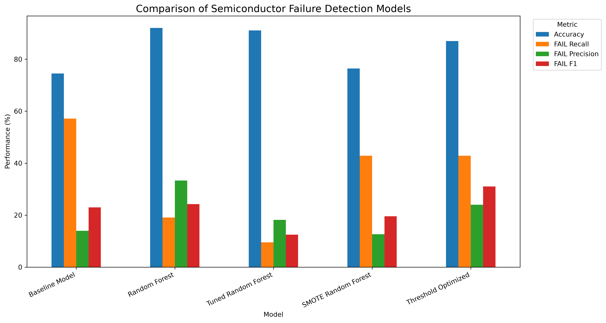
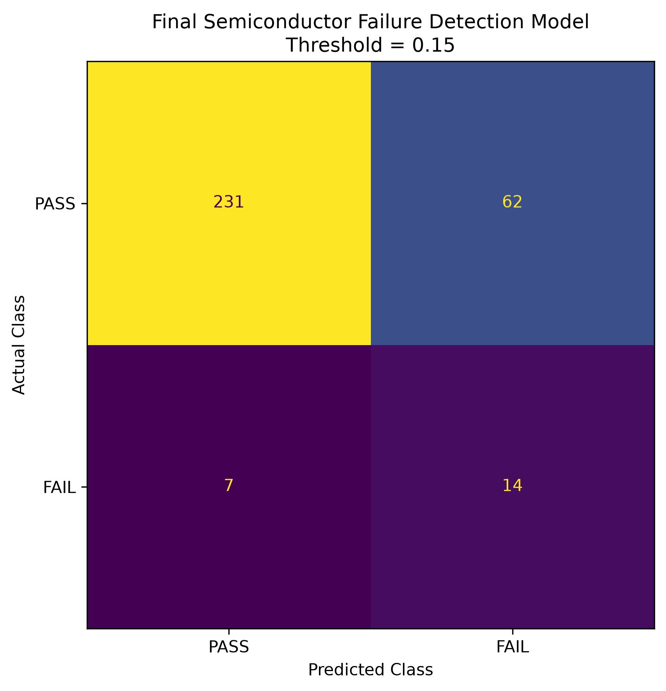
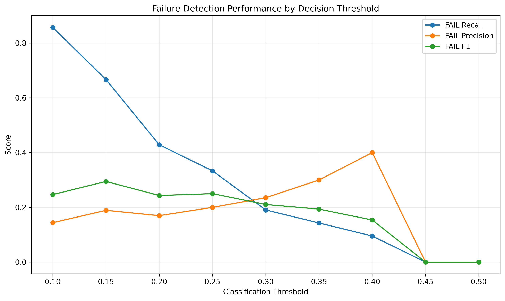
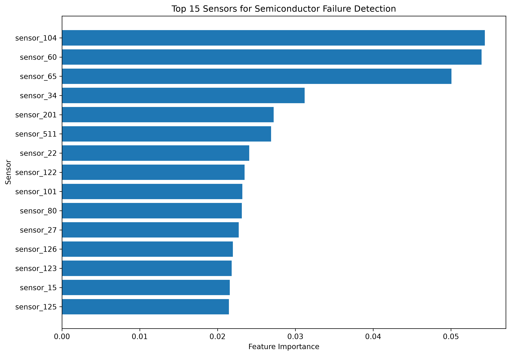
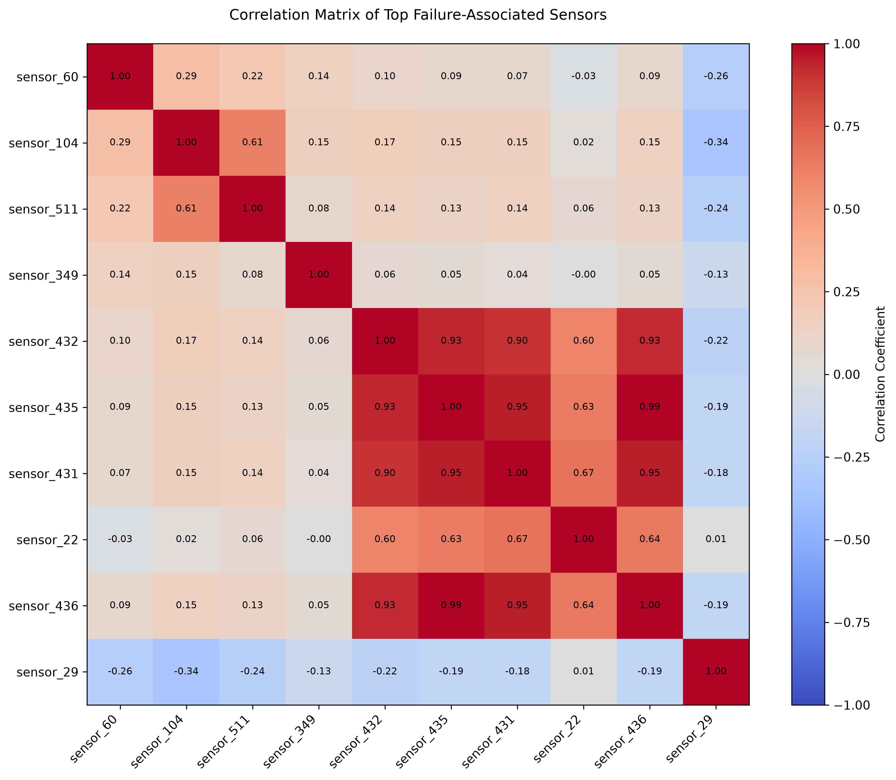

# Semiconductor Process Monitoring and Failure Detection Using Machine Learning

## Project Overview

Semiconductor manufacturing involves hundreds of sensor measurements collected during complex production processes. Identifying abnormal production runs early is important because undetected process failures can lead to defective products, increased manufacturing costs, and reduced production efficiency.

This project develops a machine learning pipeline for semiconductor process monitoring and failure detection. The primary objective is to classify manufacturing runs as **PASS** or **FAIL** using high-dimensional sensor data.

A major challenge in this dataset is **class imbalance**, where PASS observations significantly outnumber FAIL observations. Because of this, overall accuracy alone is not sufficient for evaluating model performance. The project therefore focuses particularly on **FAIL recall, precision, and F1-score**.

Several modeling approaches are evaluated, including:

- Baseline classification model
- Random Forest
- Hyperparameter-tuned Random Forest
- SMOTE-based Random Forest
- Decision-threshold optimization

The final approach also analyzes sensor feature importance and the trade-off between detecting more failures and generating false alarms.


## Business Problem

In semiconductor manufacturing, production equipment generates large volumes of sensor data during each manufacturing run. A failure that goes undetected may allow defective products to continue through the production process, potentially increasing waste, operational costs, and quality-control issues.

The main challenge is that failure events are relatively rare compared with successful production runs. In this project, the dataset contains **1,463 PASS runs and only 104 FAIL runs**, creating a highly imbalanced classification problem.

Therefore, the goal is not simply to achieve high overall accuracy. The model should be able to identify as many actual FAIL runs as possible while maintaining a reasonable number of false alarms.

## Project Objectives

The main objectives of this project are:

- Build a machine learning pipeline for semiconductor process monitoring.
- Clean and preprocess high-dimensional sensor data.
- Develop a baseline model for PASS/FAIL classification.
- Train and evaluate a Random Forest classifier.
- Perform hyperparameter tuning to improve model performance.
- Apply SMOTE to address class imbalance.
- Optimize the classification threshold to improve failure detection.
- Compare models using Accuracy, FAIL Recall, FAIL Precision, and FAIL F1-score.
- Identify the most important sensors contributing to failure detection.
- Translate model results into meaningful manufacturing insights.

## Key Business Question

Can machine learning identify semiconductor manufacturing failures from sensor data early enough to improve process monitoring while balancing missed failures against false alarms?


## Dataset Description

This project uses semiconductor manufacturing process data containing sensor measurements collected from production runs.

### Dataset Characteristics

- **Total production runs:** 1,567
- **Original sensor variables:** Hundreds of process sensor measurements
- **Target variable:** `result`
- **PASS runs:** 1,463
- **FAIL runs:** 104
- **PASS percentage:** 93.36%
- **FAIL percentage:** 6.64%

The target variable represents the manufacturing outcome:

- `PASS` — The production run completed successfully.
- `FAIL` — The production run was identified as a failed process.

### Class Imbalance

The dataset is highly imbalanced:

| Production Result | Number of Runs | Percentage |
|---|---:|---:|
| PASS | 1,463 | 93.36% |
| FAIL | 104 | 6.64% |
| **Total** | **1,567** | **100%** |

This imbalance creates an important machine learning challenge. A model that predicts nearly every production run as PASS could achieve high accuracy while still failing to identify defective runs.

For this reason, the project evaluates models using multiple performance metrics, with particular emphasis on:

- **FAIL Recall** — How many actual failures were successfully detected.
- **FAIL Precision** — How many predicted failures were actually failures.
- **FAIL F1-score** — The balance between FAIL precision and recall.
- **Accuracy** — Overall classification performance.

### Feature Engineering

During preprocessing, sensors with excessive missing values and constant measurements were removed, while remaining missing sensor values were handled using median imputation.

Feature-selection techniques were then used to reduce the high-dimensional sensor data to the **50 most informative sensor features** for model development.

The resulting feature-engineered dataset contains:

-1,567 production runs
-50 selected sensor features
-1 target variable
-1 timestamp variable

## Project Workflow

The project follows an end-to-end machine learning workflow designed to transform raw semiconductor sensor data into an interpretable failure-detection system.

### 1. Data Collection
Semiconductor process data containing hundreds of sensor measurements and PASS/FAIL production outcomes was used as the foundation of the analysis.

### 2. Data Cleaning & Preprocessing
The raw data was prepared for analysis by handling missing values, removing unsuitable sensor variables, processing the target variable, and preparing numerical features for machine learning.

### 3. Exploratory & Correlation Analysis
Sensor relationships were analyzed to better understand the structure of the manufacturing data. Correlation analysis was used to examine relationships among selected process sensors.

### 4. Feature Engineering & Selection
The high-dimensional sensor space was reduced to 50 selected sensor features, creating a more manageable dataset for model development.

### 5. Baseline Model
A baseline classification model was developed to establish an initial benchmark for PASS/FAIL prediction.

### 6. Random Forest Modeling
A Random Forest classifier was trained to capture complex and nonlinear relationships between semiconductor sensor measurements and manufacturing outcomes.

### 7. Hyperparameter Tuning
Different Random Forest configurations were evaluated using grid search and cross-validation to determine whether model tuning could improve failure detection.

### 8. Class Imbalance Treatment
SMOTE (Synthetic Minority Over-sampling Technique) was evaluated to increase the representation of FAIL observations during model training.

### 9. Decision Threshold Optimization
Instead of relying only on the default classification threshold, multiple probability thresholds were evaluated to study the trade-off between:

- Detecting more actual failures
- Missing fewer defective production runs
- Generating additional false alarms

### 10. Model Comparison
All major modeling approaches were compared using:

- Accuracy
- FAIL Recall
- FAIL Precision
- FAIL F1-score

### 11. Final Model Evaluation
The final operating threshold was selected based on the failure-detection trade-off. A threshold of **0.15** was chosen as a practical operating point for the final analysis.

At this threshold, the final evaluation detected 14 of 21 actual FAIL runs, corresponding to a **66.67% FAIL recall.

### 12. Manufacturing Interpretation
The final results were translated into manufacturing terms by examining:

- Failures successfully detected
- Failures missed by the model
- PASS runs incorrectly flagged as failures
- Most influential process sensors
- Trade-offs between failure detection and false alarms


## Model Results & Comparison

Several machine learning strategies were evaluated to determine how effectively semiconductor manufacturing failures could be detected.

| Model | Accuracy | FAIL Recall | FAIL Precision | FAIL F1 |
|---|---:|---:|---:|---:|
| Baseline Model | 74.52% | 57.14% | 14.00% | 23.00% |
| Random Forest | 92.04% | 19.05% | 33.33% | 24.24% |
| Tuned Random Forest | 91.08% | 9.52% | 18.18% | 12.50% |
| SMOTE Random Forest | 76.43% | 42.86% | 12.68% | 19.57% |
| Threshold-Optimized Final Model | 78.03% | **66.67%** | 18.42% | **28.87%** |

### Model Comparison



The results demonstrate why accuracy alone can be misleading for highly imbalanced manufacturing data.

The standard Random Forest achieved approximately **92% accuracy**, but detected only **19.05% of actual FAIL runs**. Hyperparameter tuning increased neither failure detection nor the FAIL F1-score, with the tuned model detecting only 9.52% of failures.

SMOTE improved failure recall to 42.86%, demonstrating that addressing class imbalance can help the model recognize minority-class observations.

The final threshold-optimized approach prioritized failure detection by reducing the classification threshold to **0.15. At this operating point, FAIL recall increased to 66.67%, meaning the model successfully identified 14 of the 21 actual failures in the test set.

This improvement comes with a trade-off: lowering the threshold increases the number of PASS runs incorrectly flagged for inspection. In a manufacturing environment, this threshold can therefore be adjusted depending on the relative cost of missed failures versus false alarms.

## Final Model Evaluation

After comparing the different modeling approaches, a decision threshold of **0.15** was selected as the final operating point.

### Final Confusion Matrix



The final model produced the following results on the test set:

| Actual Outcome | Correctly Classified | Incorrectly Classified |
|---|---:|---:|
| PASS | 231 | 62 |
| FAIL | 14 | 7 |

### Final Performance

- **Test observations:** 314
- **Actual PASS runs:** 293
- **Actual FAIL runs:** 21
- **Correctly detected FAIL runs:** 14
- **Missed FAIL runs:** 7
- **PASS runs incorrectly flagged:** 62
- **Accuracy:** 78.03%
- **FAIL Recall:** 66.67%
- **FAIL Precision:** 18.42%
- **FAIL F1-score:** 28.87%

### Manufacturing Interpretation

The final model successfully detected **14 out of 21 actual manufacturing failures**.

Compared with using a higher classification threshold, the lower **0.15 threshold** allows the monitoring system to identify substantially more potentially defective production runs.

However, this increased sensitivity also generates more false alarms. In the final test set, **62 successful PASS runs were incorrectly classified as FAIL**.

From a manufacturing perspective, this represents an operational trade-off:

> A lower threshold increases the number of production runs requiring additional inspection, but reduces the risk of allowing an actual process failure to go undetected.

The appropriate threshold in a real production environment would ultimately depend on the financial and operational costs associated with false alarms, additional inspections, defective products, and missed manufacturing failures.


## Decision Threshold Analysis

Machine learning classifiers typically use a default probability threshold of **0.50** to assign class labels. However, because semiconductor failures are rare, the default threshold was not effective for detecting enough FAIL observations.

To address this issue, multiple decision thresholds were evaluated.

### Threshold Performance



The threshold analysis demonstrates the trade-off between **FAIL recall, FAIL precision, and FAIL F1-score**.

Lowering the decision threshold makes the model more sensitive to potential manufacturing failures. As the threshold decreases, more actual FAIL runs are identified, but more PASS runs may also be incorrectly flagged.

A threshold of **0.15** was selected as the final operating point because it provided a useful balance for this experiment:

- **FAIL Recall:** 66.67%
- **FAIL Precision:** 18.42%
- **FAIL F1-score:** 28.87%
- **Actual FAIL runs detected:** 14 out of 21
- **Actual FAIL runs missed:** 7

### Why Not Use the Default 0.50 Threshold?

For an imbalanced manufacturing problem, optimizing only for overall accuracy can produce a model that performs well on the majority PASS class while failing to detect the minority FAIL class.

Threshold optimization allows the model's operating behavior to be aligned more closely with the manufacturing objective of identifying potentially defective production runs.

The selected **0.15 threshold should not be interpreted as universally optimal**. In a real semiconductor production environment, the operating threshold should be selected based on the relative business cost of:

- Missing an actual manufacturing failure
- Inspecting a correctly manufactured run
- Production downtime
- Additional quality-control procedures
- Defective products reaching later manufacturing stages


## Feature Importance & Key Sensors

Understanding which sensor measurements contribute most strongly to model predictions is important for interpreting the semiconductor failure-detection system.

Random Forest feature importance was used to identify the sensor variables that had the greatest influence on the model.

### Top Sensor Feature Importance



The analysis identified several sensors as particularly influential, with the highest-ranked features including:

- `sensor_104`
- `sensor_60`
- `sensor_65`
- `sensor_34`
- `sensor_201`
- `sensor_511`
- `sensor_22`
- `sensor_122`
- `sensor_101`
- `sensor_80`

Among these variables, `sensor_104`, `sensor_60`, and `sensor_65` showed the highest feature-importance scores in the final model.

### Manufacturing Interpretation

Feature importance helps identify process measurements that may deserve additional attention during semiconductor production monitoring.

Rather than treating hundreds of sensor measurements equally, manufacturing and quality teams could use these results as a starting point for investigating which process signals are most associated with model predictions.

However, feature importance should not automatically be interpreted as a causal relationship. A sensor receiving high importance means that it was useful to the predictive model, but it does not prove that the corresponding process measurement directly causes manufacturing failures.

Further engineering analysis and domain knowledge would be required before making process-control decisions based on individual sensors.

## Sensor Correlation Analysis

Correlation analysis was performed to better understand relationships among the selected semiconductor process sensors.

### Sensor Correlation Heatmap



The heatmap provides a visual representation of how strongly selected sensor measurements are related to one another.

### Why Correlation Matters

Highly correlated sensors may capture similar aspects of the manufacturing process. Examining these relationships can help:

- Identify groups of sensors that behave similarly.
- Detect potential redundancy among process measurements.
- Improve understanding of interactions within the manufacturing process.
- Support future feature-selection and dimensionality-reduction decisions.

Correlation analysis is particularly useful for semiconductor datasets because hundreds of process measurements may be collected during a single production run.

However, correlation alone does not indicate that one sensor causes changes in another sensor or directly causes a manufacturing failure. It should therefore be interpreted alongside predictive modeling results and semiconductor process knowledge.

## Technologies & Tools Used

This project was developed using Python and common data science and machine learning libraries.

| Technology / Tool | Purpose |
|---|---|
| Python | Core programming language used for data analysis and machine learning |
| Pandas | Data loading, cleaning, transformation, and manipulation |
| NumPy | Numerical operations and array processing |
| Scikit-learn | Data preprocessing, model training, evaluation, hyperparameter tuning, and feature analysis |
| Imbalanced-learn | SMOTE implementation for handling class imbalance |
| Matplotlib | Data and model performance visualization |
| Seaborn | Statistical visualizations and correlation heatmaps |
| Git | Version control and project tracking |
| GitHub | Repository hosting and project documentation |
| VS Code | Development environment |

### Machine Learning Techniques

The project applies several machine learning and analytical techniques, including:

- Data preprocessing
- Missing-value treatment
- Feature selection
- Correlation analysis
- Binary classification
- Random Forest classification
- Hyperparameter tuning
- Cross-validation
- SMOTE oversampling
- Decision-threshold optimization
- Confusion matrix analysis
- Feature importance analysis
- Model performance comparison

## Project Structure

The repository is organized to separate source code, processed data, model outputs, and visualizations.

```text
semiconductor-process-monitoring/
│
├── data/
│   └── processed/
│       └── secom_features.csv
│
├── outputs/
│   ├── figures/
│   │   ├── top_sensor_correlation_heatmap.png
│   │   ├── model_comparison.png
│   │   ├── final_confusion_matrix.png
│   │   ├── final_feature_importance.png
│   │   └── threshold_performance.png
│   │
│   ├── model_comparison.csv
│   ├── final_feature_importance.csv
│   ├── final_model_metrics.csv
│   └── threshold_analysis.csv
│
├── src/
│   ├── correlation_analysis.py
│   ├── feature_engineering.py
│   ├── train_model.py
│   ├── random_forest_model.py
│   ├── tune_random_forest.py
│   ├── smote_model.py
│   ├── threshold_optimization.py
│   ├── model_comparison.py
│   └── final_evaluation.py
│
├── README.md
├── requirements.txt
└── .gitignore


## Key Findings & Business Impact

### Key Findings

The analysis produced several important findings:

- The semiconductor dataset is highly imbalanced, with only **104 FAIL runs compared with 1,463 PASS runs**.
- High classification accuracy did not necessarily translate into effective failure detection.
- The standard Random Forest achieved approximately **92% accuracy**, but detected only **19.05% of actual failures**.
- Hyperparameter tuning did not improve minority-class detection, demonstrating that model optimization based only on conventional performance measures may not solve class imbalance.
- SMOTE increased FAIL recall to **42.86%**, showing the value of explicitly addressing the minority class.
- Decision-threshold optimization produced the strongest failure-detection trade-off in this experiment.
- At the selected **0.15 threshold**, the final model detected **14 of 21 failures**, achieving **66.67% FAIL recall**.
- Feature-importance analysis identified sensors such as `sensor_104`, `sensor_60`, and `sensor_65` as influential predictors in the model.

## Business Impact

From a manufacturing perspective, the project demonstrates how machine learning can support a more proactive approach to process monitoring.

Instead of relying only on overall prediction accuracy, manufacturers can adjust the model's decision threshold according to the operational cost of missing a defective production run versus investigating a false alarm.

The final model prioritizes identifying potentially problematic runs, allowing manufacturing or quality-control teams to investigate them before they progress further through the production process.

Potential business benefits include:

- Earlier identification of potentially defective production runs
- Reduced risk of undetected process failures
- More targeted quality-control inspections
- Better utilization of high-dimensional sensor data
- Identification of sensors that may deserve further engineering investigation
- Support for data-driven manufacturing quality decisions

The results also demonstrate that machine learning should function as a **decision-support system rather than a replacement for engineering judgment**. Further validation, process expertise, and cost analysis would be required before deploying the model in a real semiconductor manufacturing environment.


## Conclusion

This project demonstrates an end-to-end machine learning approach for detecting failures in semiconductor manufacturing using high-dimensional sensor data.

The analysis showed that **high overall accuracy does not necessarily mean strong failure detection**, particularly when working with highly imbalanced manufacturing data. While the standard Random Forest achieved approximately 92% accuracy, its ability to identify actual FAIL runs was limited.

By exploring class-imbalance techniques and decision-threshold optimization, the final approach placed greater emphasis on detecting manufacturing failures. Using a **0.15 decision threshold**, the model identified **14 of 21 actual FAIL runs**, achieving a **66.67% FAIL recall**.

The project also used feature-importance and correlation analysis to provide additional insight into influential process sensors.

Overall, the project highlights how machine learning can support semiconductor quality monitoring while demonstrating the importance of aligning model evaluation with the underlying business and operational objective.